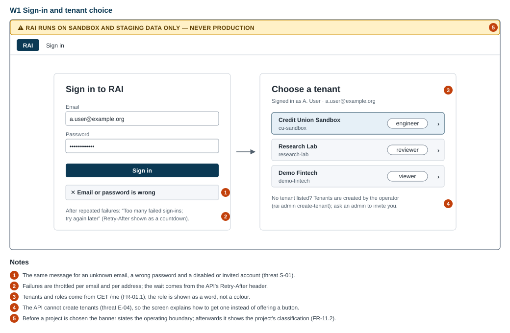
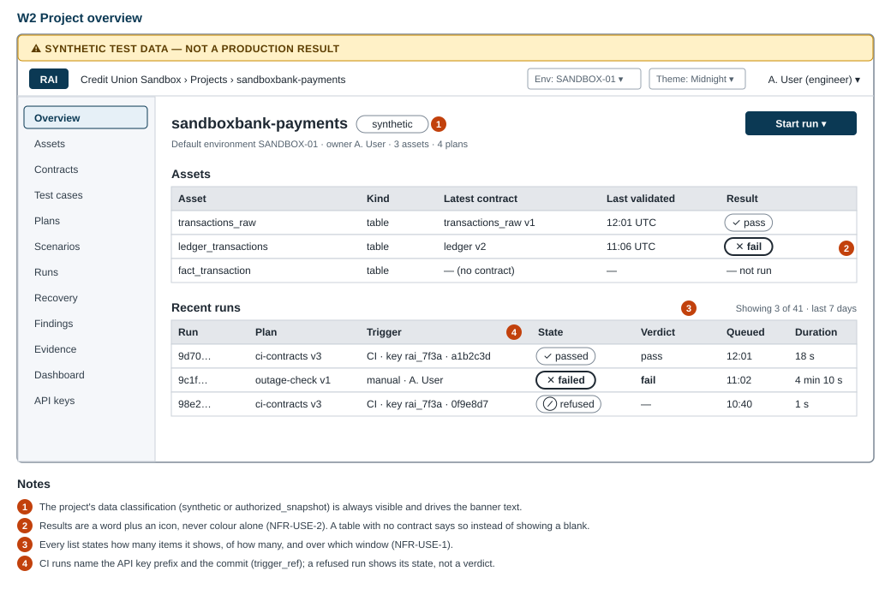
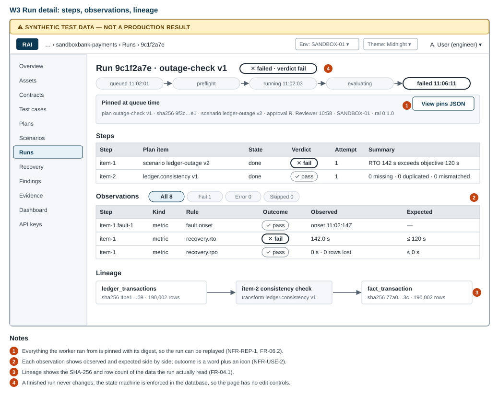
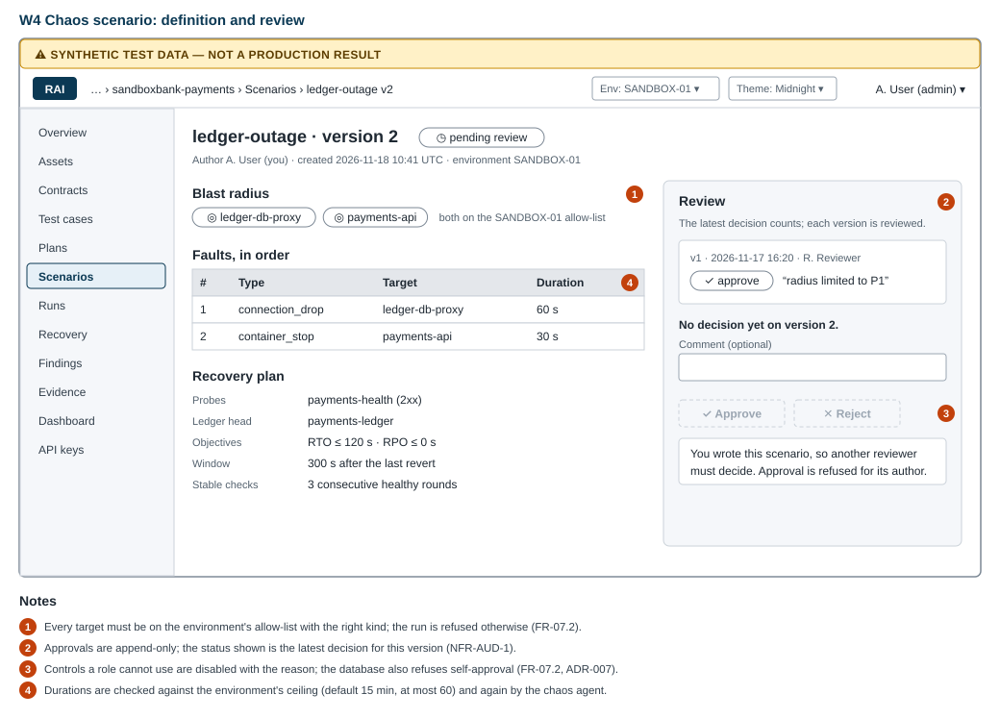
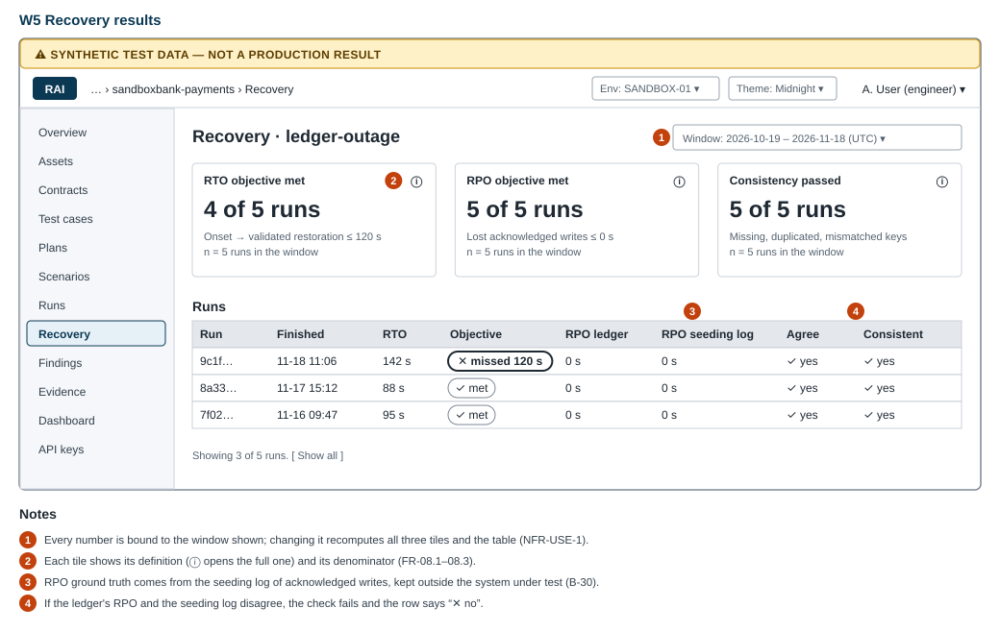
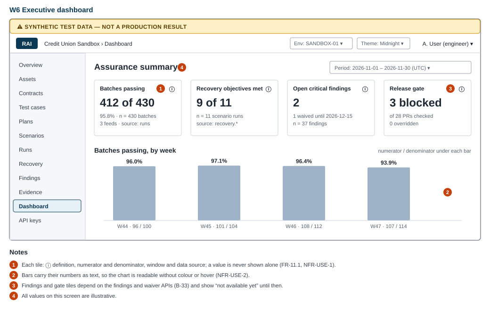
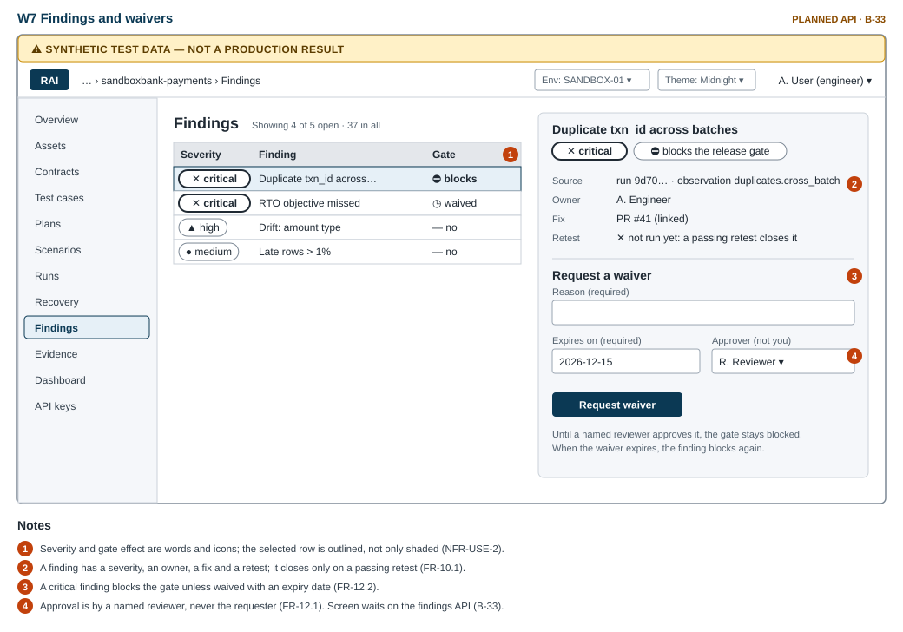
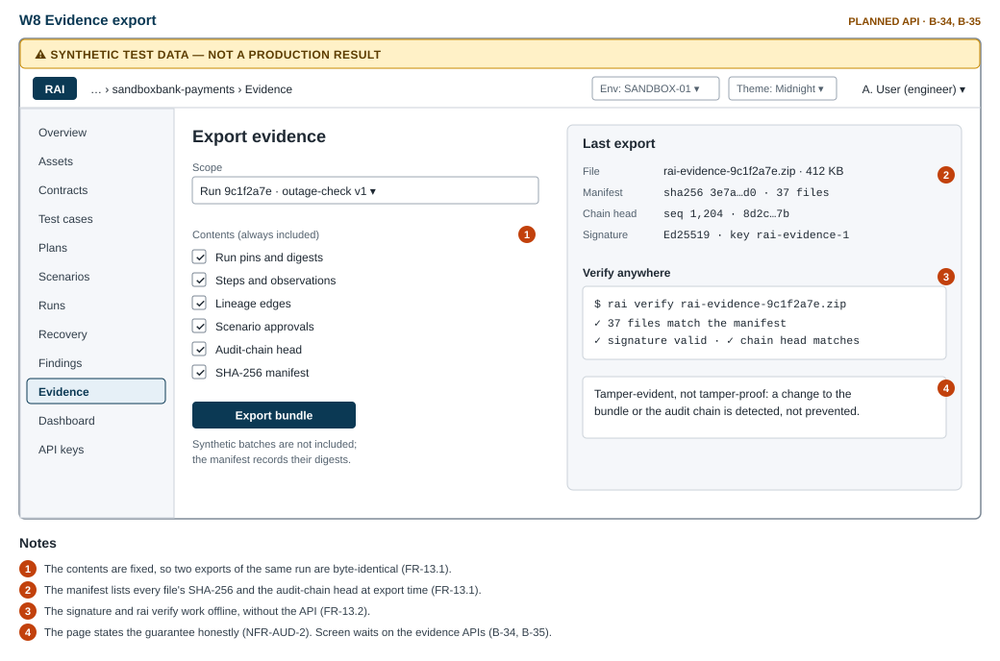

# Resilinet-AI (RAI): MVP Wireframes

| | |
| --- | --- |
| **Version** | v0.2 (reconstructed draft), 2026-11-17; screens drawn 2026-11-18 |
| **Status** | Draft. **Pending review and approval by the author of record**, Trevor Kauyu (ADR-007) |
| **Supersedes** | Nothing. The v0.1 original (2026-11-13) has not been found; if it is, it takes precedence over this draft |

> **How this document was made.** The v0.1 wireframes were never exported, and the UI (`rai-web`, React and TypeScript, ADR-004) has not been built yet. These wireframes were drafted by an AI assistant (Claude Code): the screen list on 2026-11-17, and the eight drawings on 2026-11-18, from the requirements in `docs/traceability.csv` and the data the API already returns. They are **low-fidelity layouts, not the v0.1 designs**. Field names follow the API, so every value shown has a source; **the values themselves are illustrative**.

## 1. Rules for every screen

- **Persistent synthetic-data banner (FR-11.2)** on every page, which cannot be dismissed: *SYNTHETIC TEST DATA — NOT A PRODUCTION RESULT*. For an `authorized_snapshot` project it reads *AUTHORISED SNAPSHOT — SANDBOX ONLY*. Before a project is chosen (W1) it states the operating boundary.
- **Every metric shows its definition, n and window (NFR-USE-1).** A number never appears without its denominator and the period it covers; the ⓘ next to it opens the definition.
- **Themes (D10):** Midnight (dark, default), Clarity, Evergreen and High contrast. The drawings are theme-neutral greyscale. All four themes meet **WCAG 2.2 AA** (NFR-USE-2): contrast, keyboard operation, visible focus, no information carried by colour alone (every status has a word and an icon, and a selected row is outlined as well as shaded).
- **Read-only by role.** Controls a role cannot use are hidden; a control that is unavailable for a reason (such as reviewing your own scenario) is shown disabled, with the reason.
- **Finished things do not change.** Runs, observations and approvals are append-only (NFR-AUD-1), so their screens have no edit controls.

## 2. Screens

| ID | Screen | Requirements | API |
| --- | --- | --- | --- |
| W1 | Sign-in and tenant choice | FR-01.1 | `POST /v1/auth/login`, `GET /v1/me` |
| W2 | Project overview | FR-03.1, FR-06.1, FR-11.2 | projects, assets, contracts, runs |
| W3 | Run detail: steps, observations, lineage | FR-06.1, FR-06.2, FR-04.1, NFR-REP-1 | `GET /v1/assurance/runs/{id}` and its `/observations`, `/lineage` |
| W4 | Chaos scenario: definition and review | FR-07.2, NFR-AUD-1 | `GET /v1/scenarios/{id}`, `POST /v1/scenarios/{id}/approvals` |
| W5 | Recovery results | FR-08.1, FR-08.2, FR-08.3 | observations `recovery.*` |
| W6 | Executive dashboard | FR-11.1, NFR-USE-1 | runs and observations; findings planned (B-33) |
| W7 | Findings and waivers | FR-10.1, FR-12.1, FR-12.2 | *planned* (B-33) |
| W8 | Evidence export | FR-13.1, FR-13.2, NFR-AUD-2 | *planned* (B-34, B-35) |

Each drawing has numbered callouts, explained in the notes under it. The drawings are SVG files in [`wireframes/`](wireframes/), generated by `scripts/draw_wireframes.py`; to change a screen, edit its function there and re-run `uv run python scripts/draw_wireframes.py`.

### W1. Sign-in and tenant choice

### W2. Project overview

### W3. Run detail

### W4. Chaos scenario: definition and review

The viewer here is the scenario's author, who is also an admin and so may review other people's scenarios. An engineer, who cannot review at all, would not see the review controls.

### W5. Recovery results

### W6. Executive dashboard

### W7. Findings and waivers *(planned API)*

### W8. Evidence export *(planned API)*

## 3. Traceability

Every requirement cited here is in `docs/traceability.csv`. The UI itself is not built, so no requirement is marked as satisfied by these wireframes; they are the design input for `rai-web` and for B-37 (the banner in the UI).

## Not recoverable from the repository

- The v0.1 wireframes themselves, and any screens they had beyond W1–W8.
- v0.1's navigation structure; the side navigation drawn here follows the API's resources.
