# Resilinet-AI (RAI): MVP Wireframes

| | |
| --- | --- |
| **Version** | v0.2 (reconstructed draft), 2026-11-17; screens redrawn 2026-11-18 from the recovered v0.1 screen 01 |
| **Status** | Draft. **Pending review and approval by the author of record**, Trevor Kauyu (ADR-007) |
| **Baseline** | This document (decision DESIGN-V03). The other v0.1 screens, found on 2026-11-20, are not adopted; the release decision on W05 comes from them (B-42) |

> **How this document was made.** The v0.1 wireframes were made on 2026-11-13 in a visual design tool and were never exported to this repository. One of them, *01 Executive dashboard (FR-11)*, was recovered on 2026-11-18 and is kept unchanged in [`wireframes/v0.1/`](wireframes/v0.1/). The other screens here were drawn on 2026-11-18 by an AI assistant (Claude Code) in the design language of that screen. Their content comes from the requirements in `docs/traceability.csv`, the platform modules M01–M14 (Spec section 3), and the data the API already returns. They are **not the v0.1 designs**. Field names follow the API and the SandboxBank contracts. **All values are illustrative and synthetic.**

## 1. The recovered v0.1 screen

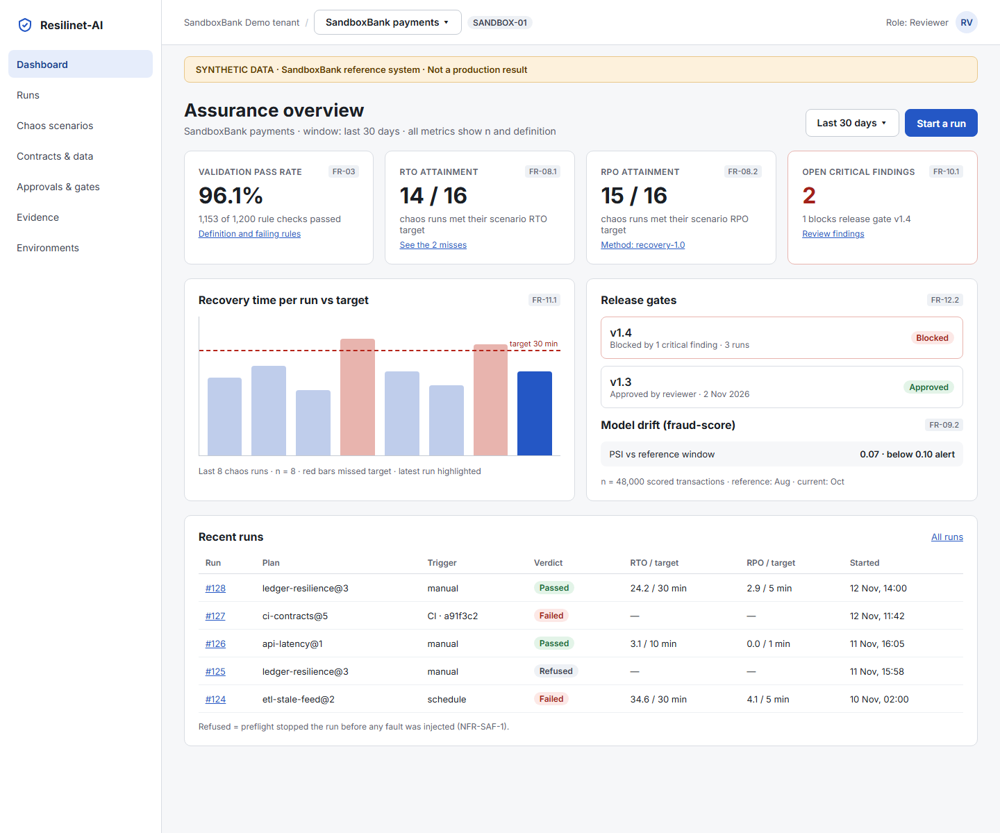

*v0.1 screen 01, Executive dashboard, as made on 2026-11-13* (file [`wireframes/v0.1/2026-11-13-01-executive-dashboard.html`](wireframes/v0.1/2026-11-13-01-executive-dashboard.html), SHA-256 `8589a5689ec5c030…`, a standalone page from the design tool). It sets the design language for the other screens:
- a left navigation: Dashboard, Runs, Chaos scenarios, Contracts & data, Approvals & gates, Evidence, Environments;
- a project header with tenant, project, environment and role;
- the synthetic-data banner;
- cards with an uppercase label and a requirement tag;
- tables of runs with verdict pills;
- every metric with its numerator, denominator and window.

## 2. Rules for every screen

- **Persistent synthetic-data banner (FR-11.2)** on every page. It cannot be dismissed and reads *SYNTHETIC DATA · SandboxBank reference system · Not a production result* (v0.1 wording). An `authorized_snapshot` project reads *AUTHORISED SNAPSHOT · sandbox only*. Before a tenant is chosen, the banner states the operating boundary instead.
- **Every metric shows its definition, n and window (NFR-USE-1).** A number never appears without its denominator and period. Composite scores without a denominator (a single "resilience score", for example) are deliberately left out for that reason.
- **Requirement tags.** Each card carries the requirement it serves, as v0.1 does, so a reviewer can trace a screen to `docs/traceability.csv`.
- **Themes (D10).** Midnight (dark, default), Clarity, Evergreen and High contrast are switchable in the header. Clarity keeps the v0.1 palette. All four meet **WCAG 2.2 AA** (NFR-USE-2): text contrast, keyboard operation, visible focus. No information is carried by colour alone: every status pill has a word *and* an icon, missed bars are marked ✕, and a selected row is outlined as well as shaded.
- **Read-only by role.** Controls a role cannot use are hidden. A control that is unavailable for a reason, such as reviewing your own scenario, is shown disabled with the reason. Finished runs, observations and approvals are append-only (NFR-AUD-1), so their screens have no edit controls.
- **Planned features are marked.** Screens or panels that wait on an API not built yet carry a *planned* badge and name the backlog item.

## 3. Screens

The wireframe set is one self-contained page, [`wireframes/rai-wireframes.html`](wireframes/rai-wireframes.html): open it in a browser, use the navigation, and switch theme in the header. The images below are rendered from it by `scripts/render_wireframes.py`.

| ID | Screen | Modules | Requirements | API |
| --- | --- | --- | --- | --- |
| W01 | Executive dashboard (v0.1 screen 01, extended) | M11, M03, M04, M07, M08, M10 | FR-11.1, FR-11.2, FR-03, FR-04.1, FR-07, FR-08, FR-10.1 | runs and observations; findings planned |
| W02 | Runs: run detail | M06, M04 | FR-06.1, FR-06.2, FR-04.1, NFR-REP-1 | `GET /v1/assurance/runs/{id}`, `/observations`, `/lineage` |
| W03 | Chaos scenarios: definition and review | M07, M12 | FR-07.1, FR-07.2, NFR-SAF-1, NFR-AUD-1 | `GET /v1/scenarios/{id}`, `POST /v1/scenarios/{id}/approvals` |
| W04 | Contracts & data | M02, M03, M05 | FR-02.1, FR-02.3, FR-03.1–03.4, FR-05.1 | assets and contracts; connectors from operator configuration |
| W05 | Approvals & gates | M10, M12 | FR-10.1, FR-12.1, FR-12.2 | findings: `/v1/projects/{id}/findings`, `/v1/findings/{id}/retest`; waivers: `/v1/findings/{id}/waivers`, `/v1/waivers/{id}/decisions`; gate: `/v1/projects/{id}/gate` |
| W06 | Evidence | M13 | FR-13.1, FR-13.2, NFR-AUD-2 | `GET /v1/assurance/runs/{id}/evidence`, `GET /v1/evidence/public-key`; `rai verify` |
| W07 | Environments (admin) | M01, M07 | FR-07.2, NFR-SAF-1 | `/v1/environments`, `/v1/environments/{id}/targets` |
| W08 | Recovery | M08 | FR-08.1, FR-08.2, FR-08.3 | `GET /v1/assurance/recovery`; consistency from observations |
| W09 | Models & drift | M09 | FR-09.1, FR-09.2 | *planned* |
| W10 | Sign-in and tenant choice | M01 | FR-01.1, NFR-SEC-1 | `POST /v1/auth/login`, `GET /v1/me` |

**Built in the UI (`web/`):** W01 Dashboard (the landing screen; its benchmark and model-drift panels and the RTO chart are not built yet), W02 Runs, W03 Chaos scenarios, W05 Approvals & gates, W06 Evidence, W08 Recovery and W10 Sign-in, with the synthetic-data banner on every screen; the rest appear in the navigation marked *planned*. Screenshots: `docs/ui/`.

W01–W07 follow the order of the v0.1 navigation. W08–W10 are added: v0.1 had no screen for recovery (M08) or model drift (M09) in its navigation, and sign-in sits outside it. **Module coverage:** every module M01–M13 has a screen. M14 (docs site, quick-start and playbooks) is documentation, not a screen.

### W01. Executive dashboard

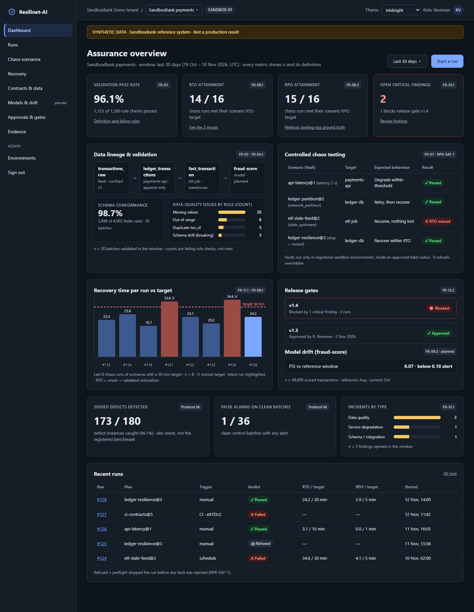

v0.1 screen 01 is kept and extended with the panels the platform's executive summary calls for:
- data lineage and validation (the P1 and P2 pipeline, schema conformance, data-quality issues by rule);
- controlled chaos testing (latest scenarios and their results);
- a TEVV summary: seeded defects detected and false alarms on clean batches (Protocol section 6), and incidents by type.

The RTO chart now shows only runs of scenarios that share its 30-minute target, labels each bar with its value and run, and marks misses with ✕ as well as colour.

### W02. Runs: run detail

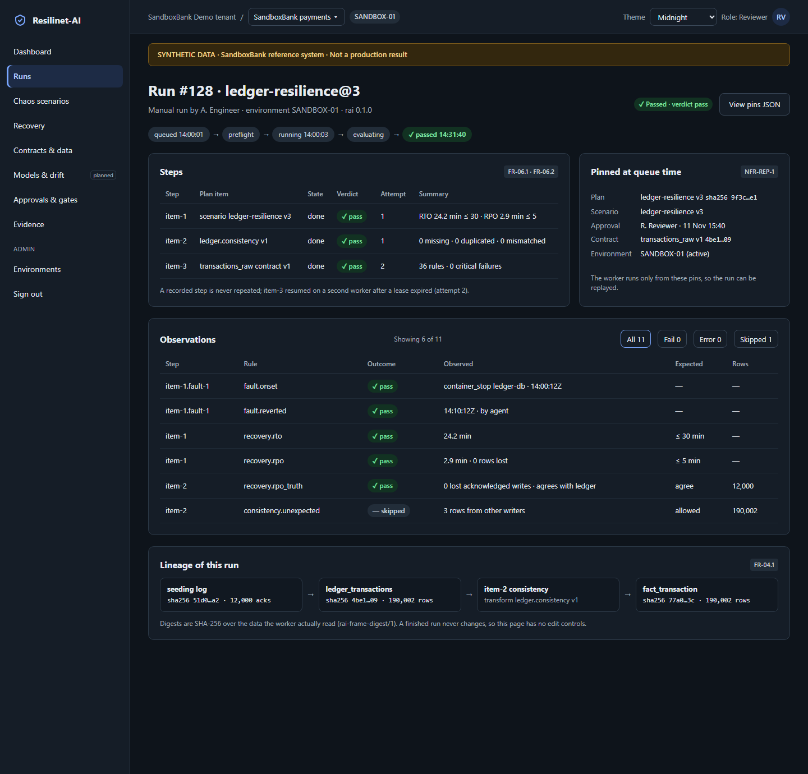

### W03. Chaos scenarios: definition and review

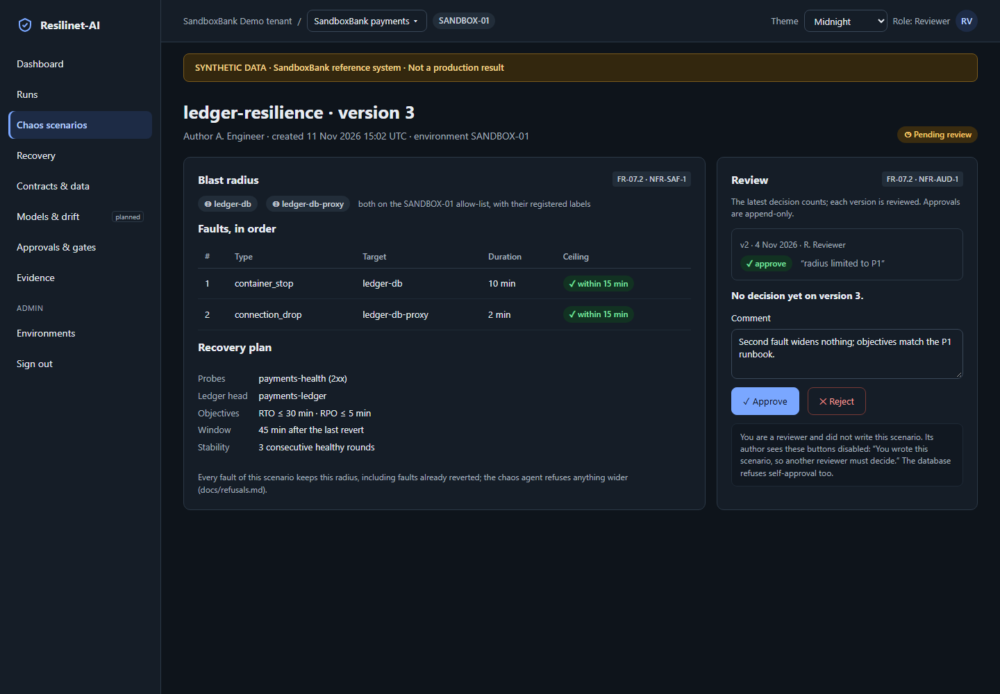

*Built*, with a list of every version in front of it. Three differences from the image: a scenario is not bound to an environment, so the header names none and the faults table has no *Ceiling* column (the agent enforces each environment's ceiling when it runs); an approval carries the expiry the reviewer chooses (B-43, default 30 days, at most 90); and the review panel says what changed from the previous version. The viewer is a reviewer who did not write the scenario, so the decision buttons are enabled. The author sees them disabled, with the reason, and the database refuses self-approval too.

### W04. Contracts & data

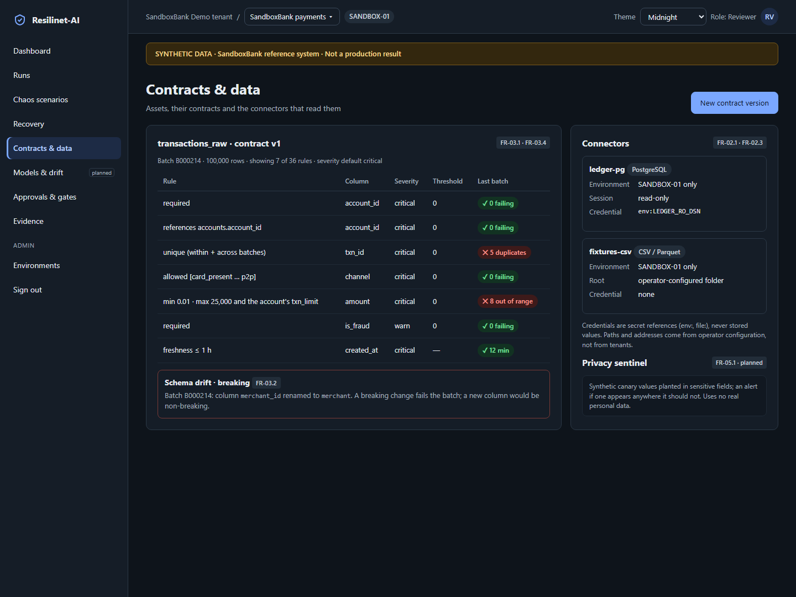

Rules, severities and limits are those of `contracts/sandboxbank/transactions_raw.yaml`.

### W05. Approvals & gates

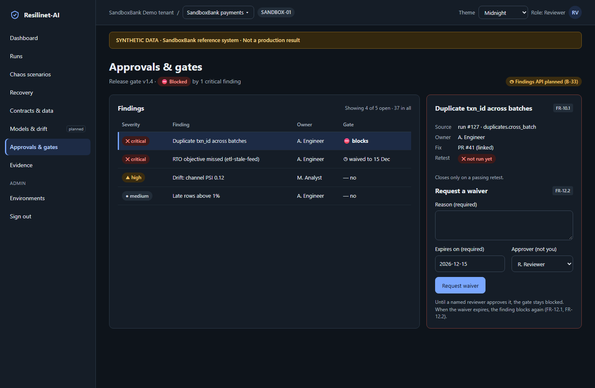

*Built.* Two differences from the image: a waiver names no approver when it is asked for, since any reviewer other than its requester and the finding's owner may decide it (FR-12.1); and the findings count has no "in all" total, which the API does not return. Under the gate, a **release decision** panel (B-42). The reviewer names the release (for example `v1.4`) and chooses approve or reject with a justification. Approve is disabled, with the reason, while the gate is blocked, and the decision records the gate's state at that moment in the audit chain.

### W06. Evidence

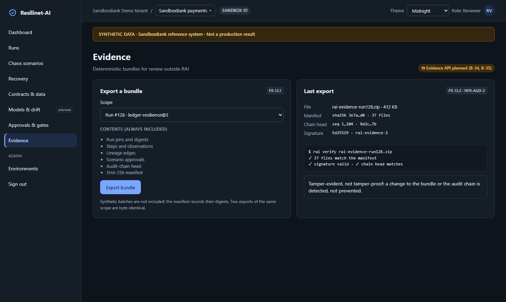

*Built*, on the evidence API (B-34, B-35), so the *planned* badge is gone. Three differences from the image. The screen does not show a `rai verify` result: it gives the command to run, with the server's public key, because a check run by the server whose bundles are being checked would prove nothing. The scope is a finished run, the only scope the API exports. After an export, the screen reads `bundle.json` from the saved file and shows the anchor, the counts and the bundle's own limitations statement (B-45).

### W07. Environments

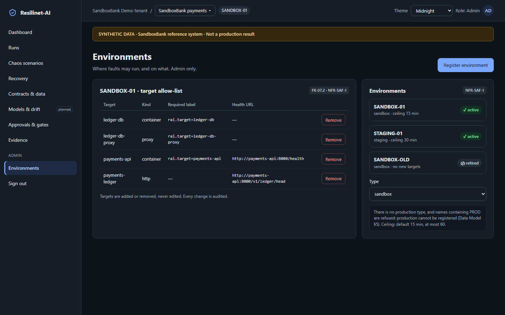

### W08. Recovery

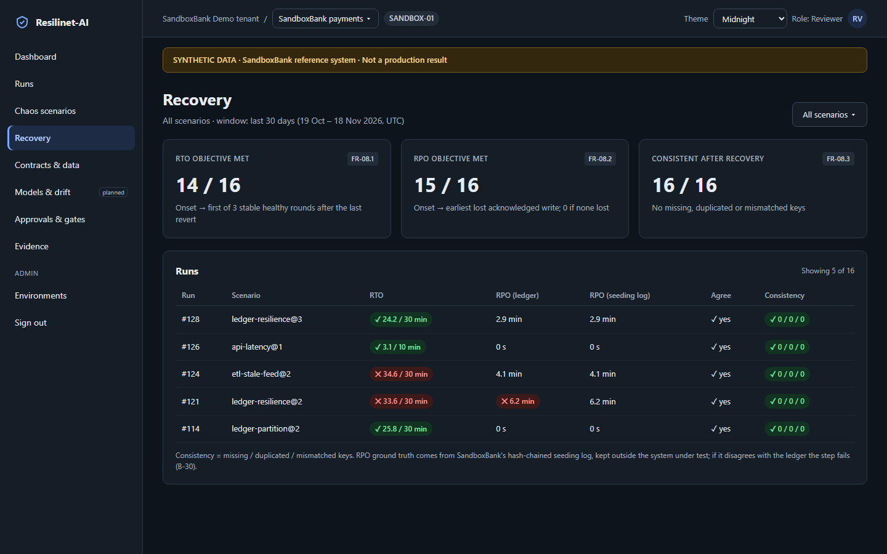

### W09. Models & drift *(planned API)*

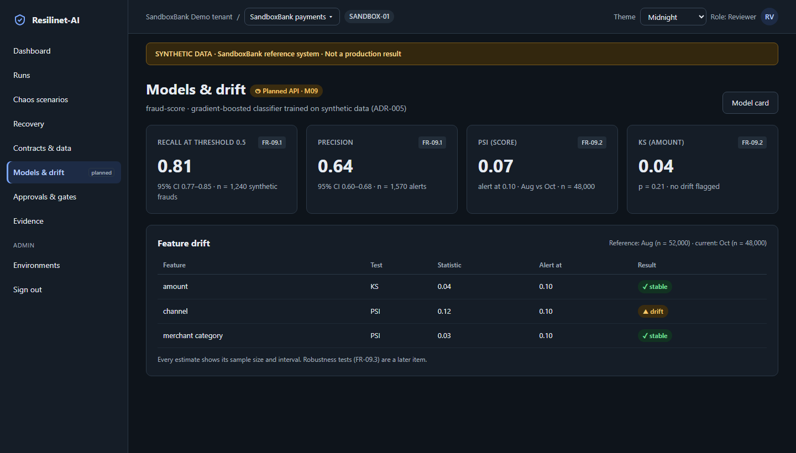

### W10. Sign-in and tenant choice

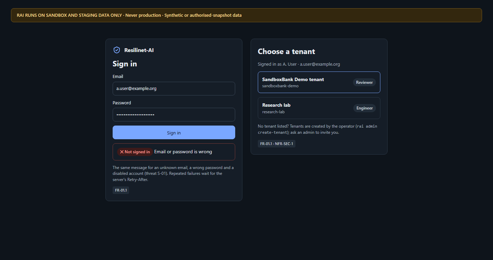

## 4. Themes

The same dashboard in the three other themes (Midnight is above):

| Clarity (the v0.1 palette) | Evergreen | High contrast |
| --- | --- | --- |
| 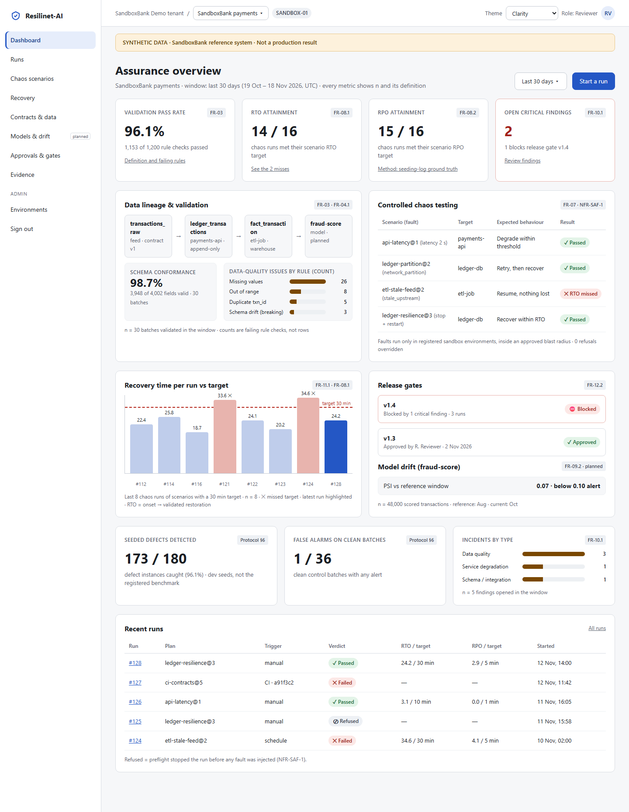 | 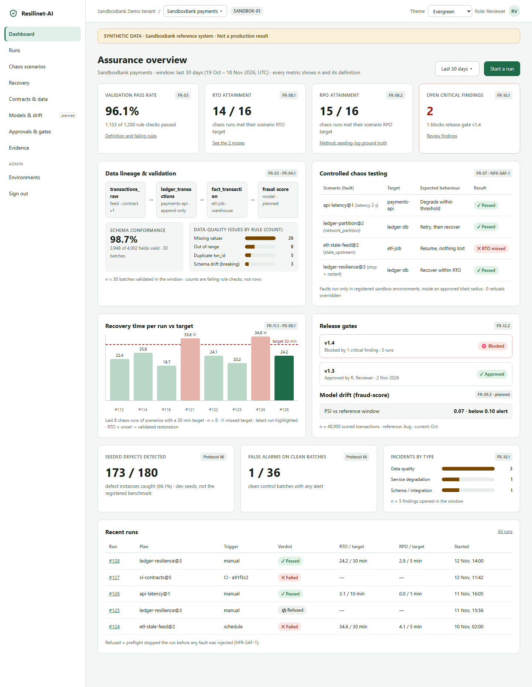 | 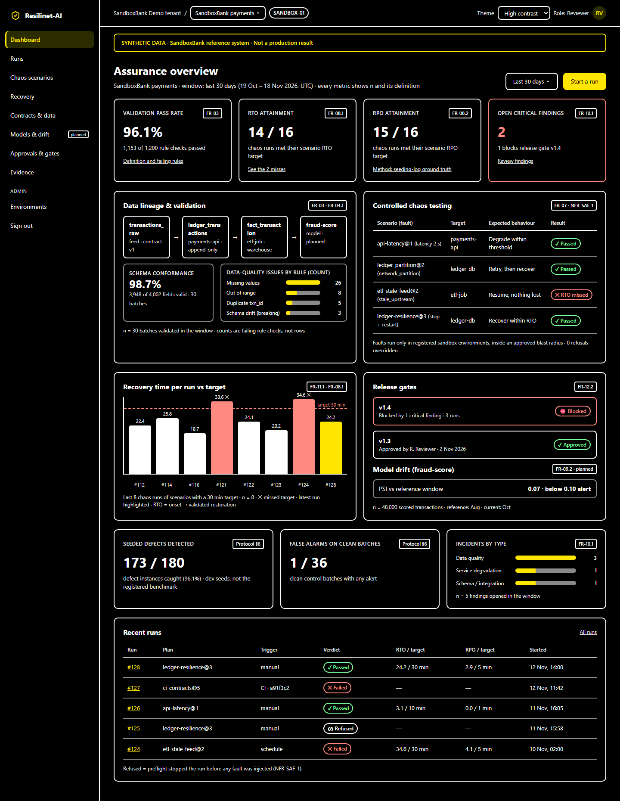 |

## 5. Differences from v0.1 screen 01

- **Theme switcher and Midnight default** (D10). v0.1 is drawn in the light palette, which is kept as Clarity.
- **Status pills gain an icon** (✓ ✕ ⊘ ◷ ▲) beside the word, and missed bars are marked ✕, so status never depends on colour (NFR-USE-2).
- **The RPO card's method link** reads "seeding-log ground truth" instead of "recovery-1.0", because RPO is now checked against the seeding log (B-30).
- **Two navigation items added:** Recovery and Models & drift (planned).
- **The RTO chart** restricted to one target, as above.

## 6. Traceability

Every requirement cited here is in `docs/traceability.csv`. No requirement is marked as satisfied by these wireframes: the matrix credits the tests of the built UI, not the designs. The UI (`rai-web`, ADR-004) has sign-in, the shell with the synthetic-data banner, Runs, the Dashboard, Chaos scenarios, Approvals & gates, Evidence and Recovery built (B-37, FR-11.1, FR-07, FR-10, FR-12, FR-13, FR-08); the other screens are placeholders, and these wireframes remain their design input.
