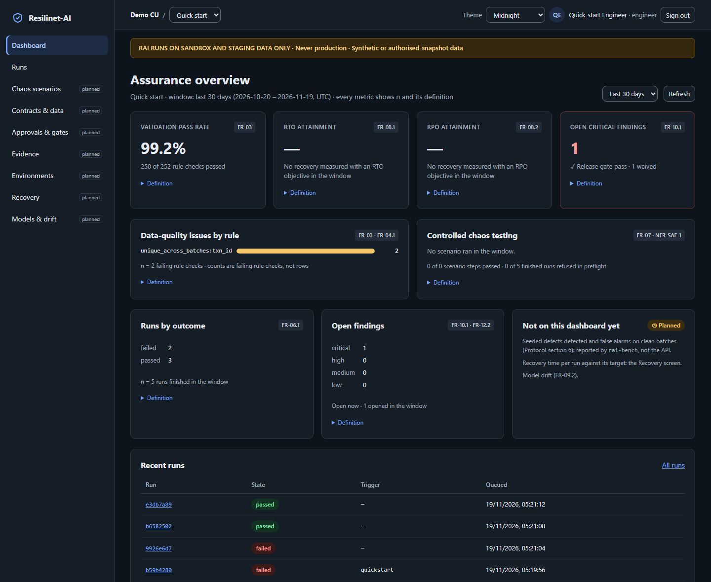

# Resilinet-AI

**An open reference framework for proving that AI-enabled financial data pipelines catch bad data and recover from failures within stated targets, before changes reach production.**

RAI brings together four things that smaller banks, credit unions and fintechs rarely have in one place:

- **Data-integrity validation:** declarative data contracts, schema-drift and duplicate detection.
- **Controlled fault injection:** sandbox-only, approved, time-boxed, with a kill switch.
- **Measured recovery:** RTO and RPO against each scenario's objectives, plus consistency checks after recovery.
- **Evidence:** signed, tamper-evident bundles that anyone can verify offline.

> **Status: pre-alpha.** Everything here runs on synthetic data from SandboxBank, RAI's reference payments system. Nothing describes a real institution.

## Where to start

| You want to | Read |
| --- | --- |
| See RAI work, in 5 minutes, without a server | [Quick start, part 1](quickstart.md#1-validate-a-batch-5-minutes-no-server) |
| Run the platform on your machine, with the dashboard | [Quick start, part 2](quickstart.md#2-run-the-platform-15-minutes) |
| Do a specific job: gate CI, triage a failure, run a chaos scenario, stop every fault, verify evidence | [Playbooks](playbooks/index.md) |
| Look something up | The reference pages: [API](api.md), [connectors](connectors.md), [chaos agent](chaos-agent.md), [refusals](refusals.md), [deployment](deployment.md), [observability](observability.md), [supply chain](supply-chain.md) |
| Understand why it is built this way | [Threat model](threat-model.md), [decision log](decision-log.md), [design documents](design/README.md) |

## Safety boundaries

These hold everywhere, and the software enforces them rather than trusting the user:

- Fault injection runs **only** against registered SANDBOX or STAGING environments. Production cannot even be registered, and unknown targets are refused ([refusal catalogue](refusals.md)).
- RAI uses **synthetic or explicitly authorised data only**. It never processes real customer personal data.
- RAI makes **no autonomous financial decisions** and **no regulatory or compliance claims**.
- No offensive security testing of any kind.

## Licence

Apache License 2.0. Contributions need a DCO sign-off, checked on every pull request ([CONTRIBUTING.md](../CONTRIBUTING.md)).
