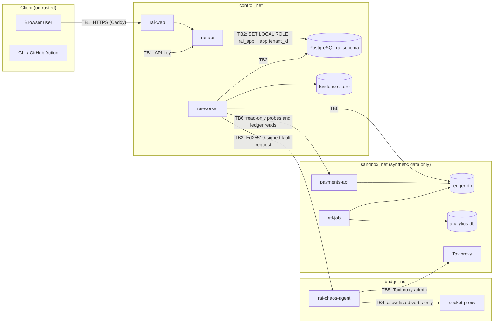

# Threat model v1 (STRIDE)

| | |
| --- | --- |
| **Requirement** | NFR-SEC-4 (backlog B-06) |
| **Version** | 1.0, 2026-11-13. Covers the design, plus the code merged up to B-05 |
| **Owner** | Trevor Kauyu |
| **Method** | STRIDE per element and trust boundary, using the Architecture & Design v0.1 data flows |
| **Review** | At every release, and whenever a trust boundary, privileged component or data class changes |

## 1. Scope and assumptions

**In scope.** The four RAI processes (`rai-api`, `rai-worker`, `rai-chaos-agent`, the `rai` CLI and GitHub Action), the web UI, PostgreSQL, the evidence store, SandboxBank, and the development supply chain (GitHub repository, CI, dependencies, images).

**Assumptions.** These are out of scope, and each is a stated residual risk:
- The host OS, the Docker daemon and the hardware are trusted. If an attacker controls the host, they control everything.
- RAI runs only against sandboxes and synthetic or authorised-snapshot data. It is not built to hold production personal data. That is a design rule (Spec section 2), not just a mitigation.
- The MVP runs on a single host with private Docker networks, so internal traffic is unencrypted. mTLS is a listed upgrade path.
- Database superusers are trusted operators. The audit chain makes their changes detectable, not impossible (T-02).

## 2. System and trust boundaries

| ID | Boundary | What crosses it |
| --- | --- | --- |
| TB1 | Internet or user → RAI | Logins, API keys, uploads, evidence downloads |
| TB2 | Application → database | Every read and write; tenant and actor context |
| TB3 | Worker → chaos agent | Fault requests: the only path to fault injection |
| TB4 | Chaos agent → Docker | Container stop, start, restart and pause; network connect and disconnect |
| TB5 | Chaos agent → Toxiproxy | Network fault configuration |
| TB6 | Control plane → test-data plane | Health probes and ledger reads used to time recovery |
| TB7 | Developer → repository → CI → images | Source code, dependencies, build output |

## 3. Assets

| ID | Asset | Why it matters |
| --- | --- | --- |
| A1 | Tenant definitions and results (contracts, runs, observations, findings) | Confidentiality between tenants; the correctness of verdicts |
| A2 | Audit chain | Accountability; the basis of every evidence claim |
| A3 | Evidence bundles and signing keys | Third-party verification of results |
| A4 | Fault-injection capability (Docker socket, Toxiproxy admin) | The most powerful capability in the system: it can stop containers |
| A5 | Credentials (DB passwords, connector secrets, API keys, password hashes) | Gateways to everything else |
| A6 | Benchmark integrity (evaluation seed range, sealed answer key, frozen protocol) | The credibility of the comparative study |
| A7 | Source code, CI and release images | Every user runs what CI builds |

## 4. Threat register

**Status** values:
- **Implemented:** in `main`, with the test or setting named as evidence.
- **Partial:** part of the mitigation is in `main`; the rest is in the backlog item named.
- **Planned:** a backlog item owns it.
- **Accepted:** a known residual risk, with the reason given.

**Residual** is the risk left after the mitigation as designed: L (low), M (medium) or H (high).

### Spoofing

| ID | Element | Threat | Mitigation | Status | Residual |
| --- | --- | --- | --- | --- | --- |
| S-01 | rai-api (TB1) | Someone signs in as another user | Argon2id password hashes; short-lived JWTs; optional TOTP; uniform login errors | Planned B-16 | L |
| S-02 | rai-api (TB1) | A stolen API key is reused | Only a SHA-256 hash of each key is stored; keys are project-scoped, expire within 90 days and can be revoked; the prefix identifies the key without revealing it | Planned B-20 | M |
| S-03 | Chaos agent (TB3) | A forged or replayed fault request | Ed25519 signature from the worker's key; replay guard on run ID; the agent re-runs preflight itself | Planned B-24 | L |
| S-04 | Audit chain (TB2) | A database session claims a false actor in `app.actor_id` | Only `rai-api` and `rai-worker` hold database credentials; the actor is set from the authenticated identity in one function (`rai.core.tenancy.set_context`) | Partial: B-05 (single code path); B-16 (actor from authentication only) | M |
| S-05 | Allow-list (TB4) | A container imitates an allow-listed target | Targets must match both the `rai.sandbox=true` label and the registered name; the worker and the agent each check | Planned B-22, B-24 | L |

### Tampering

| ID | Element | Threat | Mitigation | Status | Residual |
| --- | --- | --- | --- | --- | --- |
| T-01 | Audit chain (A2) | The application edits or deletes audit entries | `rai_app` has no UPDATE or DELETE grant; a trigger refuses UPDATE, DELETE and TRUNCATE even from the owner; hashes are computed in the database, and forged `seq`, hash and time values are overwritten | Implemented B-05 (`test_audit_chain_is_insert_only`, `test_forged_chain_fields_are_overwritten`) | L |
| T-02 | Audit chain (A2) | A database superuser rewrites history and recomputes the hashes | Tamper-evident, not tamper-proof (NFR-AUD-2): an independent verifier, plus the chain head exported in every evidence bundle so a later rewrite no longer matches | Partial: verifier B-05 (`docs/audit-chain.md`); head export B-34 | M |
| T-03 | Results (A1) | Observations, measurements or approvals are changed after the fact | Append-only tables with insert-only triggers, following the B-05 pattern; corrections become new rows | Planned B-18, B-26, B-29 | L |
| T-04 | Evidence bundle (A3) | A bundle is edited after export | SHA-256 manifest; Ed25519 signature; `rai verify` | Planned B-34, B-35 | L |
| T-05 | Run definitions (A1) | A contract or scenario is edited after a run used it | A trigger freezes versions once referenced; edits create new versions | Planned B-17, B-26 | L |
| T-06 | Benchmark (A6) | RAI is tuned on evaluation fixtures, or the answer key is changed after the runs | The generator enforces seed ranges (development 0–99,999, evaluation 100,000–199,999); answer-key and fault-log hashes are committed before the runs; the protocol is frozen and registered | Partial: seed ranges B-02 (`test_seeds_outside_the_protocol_ranges_are_rejected`); sealing B-07, B-28 | M (self-evaluation bias; reduced by blind adjudication) |
| T-07 | SandboxBank ledger | Ledger rows are changed to make recovery look better | Append-only ledger trigger; RPO ground truth comes from the separate seeding log, not from the system under test | Partial: trigger B-03 (`test_ledger_is_append_only`); RPO B-30 | L |
| T-08 | Supply chain (TB7) | A malicious dependency or a hijacked GitHub Action | `uv.lock`; nightly `pip-audit`; Actions pinned to commit SHAs; Dependabot; gitleaks; SBOM and signed images | Partial: lockfile, audit, gitleaks, SHA pinning and Dependabot implemented (this PR); SBOM and cosign B-40 | M |
| T-09 | Repository (TB7) | Unreviewed or unsigned code reaches `main` | Branch protection: pull request required, required checks, signed commits, linear history, no bypass, no force-push | Implemented (GitHub settings, 2026-11-13) | L |
| T-10 | Container images (TB7) | A base image changes under the same tag | Pin base images by digest; install from the lockfile | Planned B-40 (TODO in `sandboxbank/Dockerfile`) | M |

### Repudiation

| ID | Element | Threat | Mitigation | Status | Residual |
| --- | --- | --- | --- | --- | --- |
| R-01 | Memberships, tenants | Someone denies changing a role or suspending a tenant | Triggers write an audit entry for every insert, update and delete, with the actor | Implemented B-05 (`test_tenant_and_membership_changes_are_audited`) | L (depends on S-04) |
| R-02 | Approvals, waivers | A reviewer denies approving a scenario or waiving a finding | Named reviewer; append-only approvals; audit entry; waivers expire | Planned B-26, B-33 | L |
| R-03 | Chaos agent | A fault is injected with no record of it | The agent persists active faults locally before acting; the worker records onset and refusals as observations; refused runs are kept | Planned B-23, B-24 | L |

### Information disclosure

| ID | Element | Threat | Mitigation | Status | Residual |
| --- | --- | --- | --- | --- | --- |
| I-01 | Database (TB2) | Cross-tenant reads through an application bug | RLS on every tenant table, keyed on a transaction-local `app.tenant_id`; with no tenant set, nothing is visible; a CI test fails if any `rai` table lacks RLS | Implemented B-05 (`test_tenants_only_see_their_own_rows`, `test_no_tenant_context_sees_nothing`, `test_every_rai_table_has_row_level_security`) | L |
| I-02 | Database (TB2) | **Finding:** the API connects as the schema owner and a code path forgets `set_context`, so RLS is silently bypassed (the owner is exempt) | `rai-api` and `rai-worker` log in as a dedicated role that is a member of `rai_app` only, so forgetting the context returns zero rows instead of everything | Planned B-16 (acceptance criterion) | M until B-16 |
| I-03 | Users (TB2) | **Finding:** inviting an email that already exists raises a unique-key error, which reveals the account exists in another tenant | The invite goes through a SECURITY DEFINER function that links or creates the user and always returns the same response | Planned B-16 (acceptance criterion) | M until B-16 |
| I-04 | Secrets (A5) | Secrets leak through the repository, logs or bundles | gitleaks in pre-commit and CI; `.env` is git-ignored; connection strings are never logged; connectors hold secret references only; a log scrubber; secrets are excluded from bundles | Partial: gitleaks, `.env` and logging B-01 to B-05; secret references and error scrubbing implemented B-13 (`test_literal_credentials_are_refused_in_configs`, `test_wrong_password_never_appears_in_the_error`); log scrubber B-18; bundles B-34 | L |
| I-05 | Data classes | Real personal data enters RAI | Synthetic-only rule; projects carry `data_classification`; a permanent synthetic-data banner; SandboxBank generates every identifier | Partial: SandboxBank B-02; classification B-17; banner B-37 | L |
| I-06 | Network (TB1) | Internal services are reachable from the network | Every host port is published on `127.0.0.1` only; TLS through Caddy; the API never joins `sandbox_net` | Partial: localhost binding B-03 to B-05; Caddy B-16, B-36 | L |
| I-07 | rai-api (TB1) | Responses reveal that another tenant's object exists | Another tenant's objects return 404, not 403 | Planned B-16 | L |

### Denial of service

| ID | Element | Threat | Mitigation | Status | Residual |
| --- | --- | --- | --- | --- | --- |
| D-01 | Chaos agent (A4) | A fault stays active after the agent, worker or API crashes | A watchdog reverts any fault past its maximum duration; `kill --all` works from the local state file with the API and database down | Planned B-25 | L |
| D-02 | Sandbox | A fault runs longer or wider than declared | Maximum duration ≤ the environment ceiling (15 min); declared blast radius checked by both preflights | Planned B-24, B-27 | L |
| D-03 | rai-api (TB1) | Oversized or flood requests | Request size limits; rate limits per key; batch limits | Partial: the payments-api batch cap of 1,000 is B-03; API limits B-16 | M |
| D-04 | Job queue | One tenant starves the others | Per-tenant concurrency limit; leases with a retry cap of 3 | Planned B-18 | M |
| D-05 | Audit chain | Advisory-lock contention when two tenants' `hashtext` values collide | Accepted: the only effect is that two tenants' writes are serialised briefly | Accepted | L |

### Elevation of privilege

| ID | Element | Threat | Mitigation | Status | Residual |
| --- | --- | --- | --- | --- | --- |
| E-01 | Docker socket (A4, TB4) | The agent, or an attacker in it, uses the full Docker API (exec, privileged containers, mounts) | Only the agent can reach Docker, and only through a socket proxy that allows stop, start, restart, pause and network connect/disconnect, with no exec, image or volume access; the agent sits alone on `bridge_net` | Planned B-23 | M (the Docker daemon is powerful by nature) |
| E-02 | Environments | Faults are pointed at production | The environment type enum has no PRODUCTION value; `production_flag = false` check; refusal tested | Planned B-22, B-27 | L |
| E-03 | rai-api | A user raises their own role, or approves their own scenario | RBAC per endpoint; a separation-of-duties trigger rejects reviewer = author; role changes are audited (R-01) | Partial: audit B-05; RBAC B-16; separation of duties B-26 | L |
| E-04 | Database (TB2) | The application role gains more power than it needs | `rai_app` is NOLOGIN and NOBYPASSRLS, cannot create tenants, and cannot update or delete audit entries | Implemented B-05 (`test_app_role_cannot_create_tenants_or_bypass_rls`) | L |
| E-05 | SandboxBank containers | Container breakout, or a compromised system under test reaching RAI | Images run as a non-root user; no privileged containers; SandboxBank has no route to `control_net` | Partial: non-root payments-api and etl-job images B-03; network isolation in compose; hardening B-40 | L |
| E-06 | SandboxBank payments-api | Unauthenticated callers post transactions | Accepted: synthetic system under test, reachable only on `sandbox_net` and `127.0.0.1`; adding authentication would distort the benchmark workload | Accepted | L |

## 5. Findings from this review

| # | Finding | Action | Where |
| --- | --- | --- | --- |
| 1 | If the API connected as the schema owner, a missed tenant context would bypass RLS (I-02) | Added to the B-16 acceptance criteria: a dedicated login role with `rai_app` membership only | B-16 |
| 2 | Duplicate-email errors reveal accounts in other tenants (I-03) | Added to the B-16 acceptance criteria: invite through a SECURITY DEFINER function with a uniform response | B-16 |
| 3 | GitHub Actions were referenced by movable tags (T-08) | **Fixed in this PR:** pinned to commit SHAs; Dependabot added for Actions and uv | `.github/workflows/ci.yml`, `.github/dependabot.yml` |
| 4 | Nothing stopped a future table from shipping without RLS (I-01) | **Fixed in this PR:** a CI test fails if any `rai` table has RLS disabled | `tests/integration/test_core_schema.py` |
| 5 | A Dockerfile TODO pointed at the wrong backlog item (T-10) | **Fixed in this PR:** now points at B-40 | `sandboxbank/Dockerfile` |

## 6. Review log

| Date | Version | Change | Reviewer |
| --- | --- | --- | --- |
| 2026-11-13 | 1.0 | First full model (B-06), replacing the stub | Trevor Kauyu |
| 2026-11-14 | 1.1 | I-04 status: secret references and error scrubbing implemented (B-13) | Trevor Kauyu |
