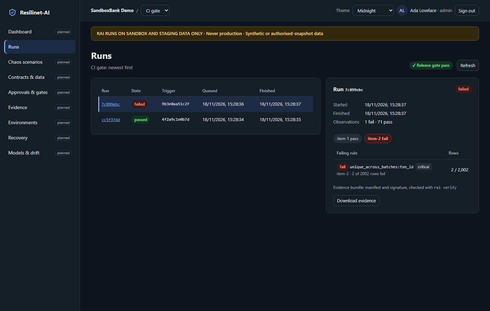

# Web UI

The RAI web UI: React and TypeScript (ADR-004), built with Vite. Its design is the wireframe set in [`docs/design/rai-wireframes.md`](../docs/design/rai-wireframes.md), and its themes are the wireframes' four: Midnight by default, Clarity, Evergreen and High contrast (decision D10).



## What it does so far

| Screen | Status | API |
| --- | --- | --- |
| Sign-in and tenant choice (W10) | Built | `POST /v1/auth/login`, `GET /v1/me` |
| Dashboard (W01) | Built, and the landing screen: validation pass rate, RTO and RPO attainment, open critical findings and the gate, issues by rule, each scenario's latest result, runs by outcome, open findings and recent runs, over a 7, 30 or 90-day window. Every number shows its denominator and a definition (NFR-USE-1). Not yet: the benchmark panels (from `rai-bench`), the RTO chart and model drift | `/v1/assurance/summary`, `/v1/projects/{id}/gate`, `/v1/assurance/runs` |
| Runs (W02) | Built: a project's runs, a run's steps and failing rules, the release gate, and the evidence download | `/v1/assurance/runs`, `/observations`, `/v1/projects/{id}/gate`, `/evidence` |
| Recovery (W08) | Built: RTO, RPO and post-recovery consistency attainment, each with its denominator and definition, and per run the RTO against its objective, the ledger's RPO, the seeding-log RPO and whether they agree, and the consistency findings (missing / duplicated / unexpected / mismatched). Filter by scenario and a 7, 30 or 90-day window. Misses carry ✕ as well as colour | `/v1/assurance/recovery`, `/v1/projects/{id}/scenarios` |
| Approvals & gates (W05) | Built: the release gate's verdict and definition; the project's findings (open or all) with severity, owner, status and effect on the gate (blocks, waived to a date, or none); one finding's source, owner, fix, retest and waivers. Engineers set the fix reference, record a retest and ask for a waiver (by UTC day, at most 90 days ahead); reviewers decide waivers and dismiss findings, disabled with the reason when it is their own; reviewers approve or reject a release, with approve disabled while the gate is blocked. Viewers and auditors see it read-only | `/v1/projects/{id}/gate`, `/findings`, `/releases`; `/v1/findings/{id}`, `/waivers`, `/retest`, `/dismiss`; `/v1/waivers/{id}/decisions`; `/v1/members` |
| Chaos scenarios (W03) | Built: every version of the project's scenarios with its review status, faults, blast radius and author; one version's blast radius, faults in order and recovery plan, and its review: the decisions so far, the previous version's decision and what changed since. Reviewers and admins approve (until a UTC day, at most 90 days ahead) or reject; the author sees both disabled with the reason; engineers, viewers and auditors see no decision controls. Publishing stays with the API and CLI | `/v1/projects/{id}/scenarios`, `/v1/scenarios/{id}`, `/v1/scenarios/{id}/approvals`, `/v1/members` |
| Evidence (W06) | Built: export a finished run's evidence bundle, which the browser saves. The screen then reads the saved bundle's `bundle.json` and manifest and shows the manifest's SHA-256 and file count, the audit-chain anchor, the signing key, what the bundle holds and its limitations statement. It also gives the `rai verify` command to run outside RAI, with the server's public key, or `--allow-unsigned` when the server does not sign, and warns when the bundle's key is not the server's current key. Any member can export | `/v1/assurance/runs`, `/v1/assurance/runs/{id}/evidence`, `/v1/evidence/public-key` |
| Environments (W07) | Built: the tenant's environments, active first, with type, fault ceiling and status, and one environment's target allow-list (kind, required label, pinned image, health and scoring URLs). Admins register an environment (a name containing PROD is refused, with the reason), change its ceiling, retire or reactivate it (sent with `If-Match`), and add or remove targets; a container needs its label and image ID, and a retired environment takes no new targets. Removing and retiring take a second click. Other roles see it read-only | `/v1/environments`, `/v1/environments/{id}`, `/targets`, `/targets/{id}` |
| Contracts & data, Models & drift | In the navigation, marked *planned*, with their requirements | — |

- **Synthetic-data banner (FR-11.2, B-37).** On every screen, sign-in included, and it cannot be dismissed. When the selected project is an authorised snapshot, the banner names it.
- **Read-only.** This slice only reads; actions (approving, waiving, starting runs) come with their screens.

## Accessibility (WCAG 2.2 AA, NFR-USE-2)

Checked on every pull request, in two halves:

- **`src/a11y.test.tsx`** runs axe-core over every built screen (sign-in, Dashboard, Runs with a run open, Chaos scenarios with a version open, Approvals & gates with a finding open, Evidence after an export, Environments as an admin, Recovery, a planned screen) and every theme, against the WCAG 2.0 to 2.2 A and AA rules, and checks that each screen sets its own page title. A first test proves axe does catch a violation, so a clean run means something.
- **`tests/unit/test_web_contrast.py`** checks colour contrast from the theme tokens in `src/styles.css`, because jsdom has no computed colours: text at least 4.5:1 and controls and focus outlines at least 3:1, for every pair the UI draws, in all four themes.

By design: a visible 3 px focus outline; a skip link; native controls only, each with a label, so everything works from the keyboard; status in words and symbols, never colour alone; `role="alert"` for errors and `role="status"` while loading; targets at least 24 px; card grids that reflow to a 320 px viewport with no sideways scrolling (tables scroll inside their card). The sign-in form names its fields (`username`, `current-password`), so password managers and pasting work.

Not automated: a screen-reader pass (NVDA or VoiceOver) and a manual keyboard pass; both are due with each new screen.

## Develop

```bash
cd web
npm ci                 # exact versions from package-lock.json
npm run dev            # http://127.0.0.1:5173, forwarding /v1 to `rai serve` on 127.0.0.1:8000
npm run check          # type-check, tests (Vitest + Testing Library) and a production build
```

`RAI_API_URL` points the dev server at another API. Run the API and a worker as in [`docs/api.md`](../docs/api.md).

## In production

`deploy/caddy/Dockerfile` builds the UI (running `npm run check` first) into the Caddy image, so the UI and the API share one HTTPS origin ([`docs/deployment.md`](../docs/deployment.md)). The CI job "Web UI" runs the same checks on every pull request.

## Security

- **Tokens in memory only.** The access and refresh tokens are never written to `localStorage`, `sessionStorage` or cookies; a reload signs you out. A 401 triggers one refresh, which rotates the refresh token, and one retry. Signing out revokes the refresh token on the server.
- **Content-Security-Policy.** Caddy serves the UI with `default-src 'self'` and `script-src 'self'`: no inline scripts, no third-party origins, no framing. The build emits no inline scripts or styles.
- **No HTML from data.** Everything the API returns is rendered as text by React; the UI never sets HTML.
- **Only a theme in storage.** `localStorage` holds the theme choice and nothing else, and the UI works without storage.

## Dependencies

Two runtime dependencies (React and React DOM) and a small development set, each pinned to an exact version. New versions are installed with `npm install --before=<a date 14 days ago>`, so nothing younger than two weeks is resolved, even transitively (decision DEP-COOLDOWN); Dependabot waits 14 days too.
